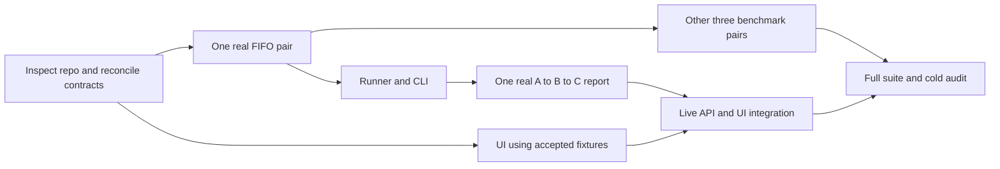

# Track C execution plan

Paths below are proposed targets. The first ticket maps them to the actual repository. Avoid putting an importable top-level Python package literally under `src` unless that is already the team's agreed layout; follow its packaging conventions. Track C must not edit Tracks A/B to make mocks pass.

## Dependency order



The three tracks can develop concurrently after shared contracts are accepted. That does not eliminate integration dependencies. Person 3 has multiple responsibilities; finish a small vertical slice before expanding the whole interface.

| Ticket | Owner/role | Allowed area | Required result and evidence |
|---|---|---|---|
| C00 | Person 3 + shared-contract owner; architecture model | Track C docs/proposals; shared contract only through agreed change | Inspect repo instructions/status/toolchain; map paths; document accepted clock/value/report semantics; fixture validates against canonical Python model |
| C01 | Person 3; Fable benchmark role | FIFO benchmark + its tests | Correct and buggy RTL with same external contract, independent queue oracle, exact directed stimulus; correct passes, mutant fails cycle 3 full check; inspect real VCD |
| C02 | Person 3; Fable benchmark role | Remaining benchmarks + tests | Three additional pairs and alternate schedules; prove MAC output latency and genuine Icarus X; no source-answer leakage |
| C03 | Person 3; Opus platform role | Runner/CLI + platform tests | Argument-array subprocesses, isolated run dirs, limits/cancel, captured provenance; distinct process/design statuses; adapters can use mocks only under explicit test configuration |
| C04 | Person 3 coordinating A/B | Application adapters + integration tests | Analyze one actual FIFO mutant and correct trace through real A/B modules; verify schema and source mapping; document localization result without fabricating a rank |
| C05 | Person 3; Astra frontend role | UI + frontend tests | Implement ui-spec.md on accepted schema/fixtures; selection/phase/unknown/large-time/responsive cases pass |
| C06 | Person 3; Opus integration + Astra UI review | Local API, UI adapter, integration tests | Real job lifecycle, source retrieval, cancel, origin/path controls; one real report navigable in all panels |
| C07 | Person 3 plus independent reviewer | Tests, reports, small fixes in owned areas | All required simulator jobs run; correct vs mutant controls; held-out schedules; cold audit issues fixed and rechecked |

## Suggested tests to create (not yet existing commands)

Once C00 establishes Python/package tooling, use the repo's environment runner to execute these intended targets. For a uv/pytest repo they would be:

```sh
uv run pytest tests/track_c/test_benchmark_oracles.py -q
uv run pytest tests/track_c/test_runner.py -q
uv run pytest tests/track_c/test_contract_adapter.py -q
uv run pytest tests/track_c/test_benchmarks_sim.py -q
uv run pytest tests/track_c/test_platform_e2e.py -q
```

Configure explicit markers for Verilator and Icarus jobs; required CI lanes must fail if their simulator is unavailable. Local missing prerequisites may produce a clear skip, but the handoff must report it as unverified. Use existing frontend build/typecheck/test commands from its package scripts, not guessed commands. Test cancellation against a real long-running subprocess as well as mocked results.

## Work-order boundaries

Keep each ticket as one reviewable change or a small sequence of atomic commits. Read the branch's existing changes first; don't overwrite another person's uncommitted work. Run focused tests after each ticket; run integration checks when dependencies change. Tests can reveal a real core defect: report it with a reproducer and coordinate with its owner rather than freezing a broken implementation forever.

Do not add broad `gh pr*` or arbitrary shell allowlists to reduce friction. Preserve existing permissions. Do not auto-merge or push to main based solely on a model's “LGTM”. Preparing changes locally is distinct from publishing or merging them.

## Handoff record after every model switch

Write `docs/handoffs/track-c-current.md` with actual branch and commit, scope completed, changed files, commands and results, simulator versions, failing/skipped checks, contract version, unresolved decisions, and the next single ticket. Commit durable work before clearing context. A model should not need the entire chat to continue.

## Release evidence

Archive machine-readable results for the four directed cases and the held-out schedules: correct/mutant, simulator, seed, source hashes, expected and observed anchor, expected and actual transaction counts, localization rank if available, duration, and analysis limits. Report raw counts and all failures. Exclude build failures and unsupported analyses from “correctly localized”; do not silently drop them from the denominator.
